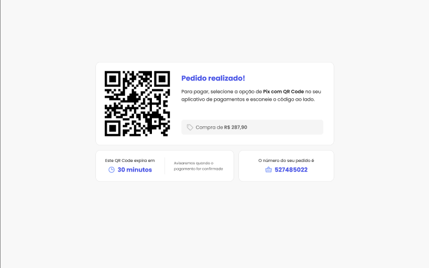
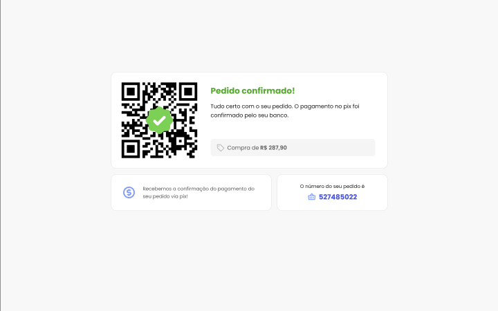
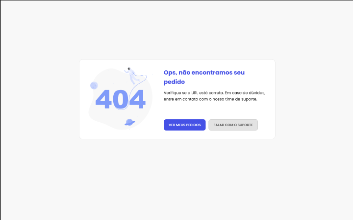

<h1 align="center">Python Flask + WebSockets</h1>

**Description**: Learning Python w/ Flask + WebSockets

- This repository was created to be used in a Python project utilizing the Flask framework to create an payment visualization page with real-time notifications.

Order Payment Page



Confirmed Payment Page



Payment Not Found Page



## Getting started

Follow step by step below to execute this project correctly:

```SH
# create venv
python3 -m venv .venv
source .venv/bin/activate # always use this command to activate venv (per terminal session)

# install dependencies
pip3 install -r requirements.txt

# most used flask cli commands
flask run # run flask app
flask shell # create/open flask instance
```

<br>
<div align="center">
  <h2>Thanks 2 everyone!</h2>
  <p>Made w/ 💙 by <a href="https://github.com/pratesMath">pratesMath</a>.</p>
</div>
